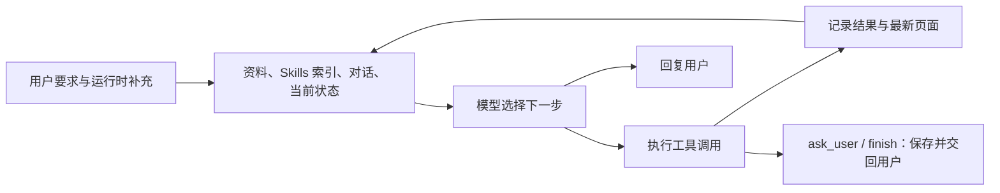
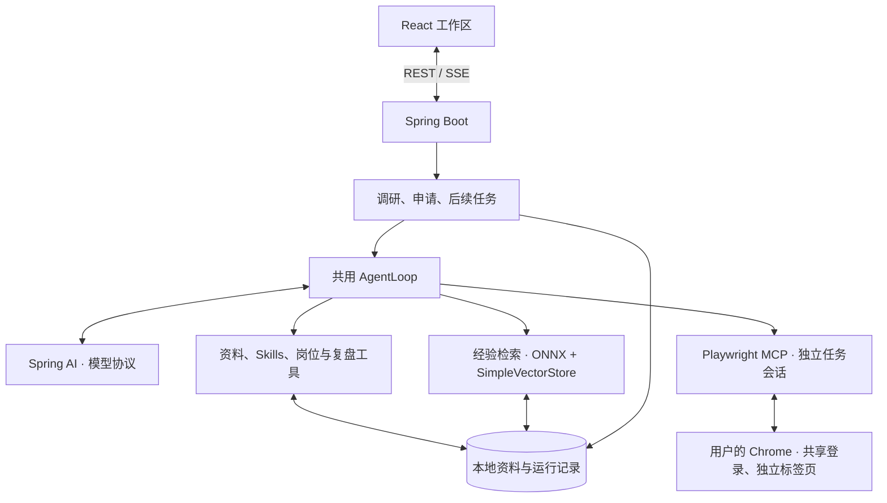

# JobApply

**JobApply 是一个在本机运行的求职 Agent，负责岗位调研、简历匹配、申请填写和投递后的跟进。** 它在用户日常使用的 Chrome 中操作招聘页面，复用已有登录状态，把申请填到最终提交前，并将岗位、材料、对话与复盘保存在本地工作区。

用户准备求职资料、说明方向，在需要时补充信息，并亲自完成登录和最终提交。每个岗位都有独立工作台，从选简历到准备面试都围绕同一份岗位记录展开。

[求职工作流](#求职工作流) · [模型驱动的工具循环](#模型驱动的工具循环) · [资料与经验复用](#资料与经验复用) · [技术实现](#技术实现) · [设计借鉴](#设计借鉴) · [本地运行](#本地运行)

## 求职工作流

JobApply 用 **Project** 组织求职方向与资料，用 **Session** 保存岗位调研对话，用 **Job 工作台** 处理单个岗位的申请和后续。侧栏按这些关系提供入口，便于在调研对话和已打开的工作台之间切换。

### 调研对话整理候选岗位

调研 Agent 根据求职要求搜索职位、读取 JD、核实官网招聘信息，并将岗位加入候选池。它结合个人画像和求职偏好说明岗位要求与匹配情况，保留 JD 快照和调研备注，供工作台继续使用。

### 岗位工作台完成简历匹配与填写

申请 Agent 在工作台中比较已有简历与当前 JD，给出匹配排名和修改建议。它把用户确认的简历设为本次上传材料，再调用浏览器工具填写申请。简历讨论、材料选择、表单填写和填写报告保存在同一个岗位下，多份申请各自保留对话。

JobApply 将简历选择放在工作台，是因为匹配结论属于具体岗位：同一个 Session 可以找到多个岗位，但每个岗位需要的经历重点和简历版本不同。工作台在材料准备阶段延迟打开招聘页面，直到需要浏览器操作时再建立标签页；选定的简历立即进入本次文件清单，下一次工具调用即可上传。

### 后续对话记录 OA、面试与复盘

JobApply 在用户告知已提交后，在原工作台开启独立的后续对话，沿用岗位与简历信息，记录 OA、面试轮次和复盘。后续 Agent 将题目与经验汇总到题库和公司记录，投递过程仍保留在工作台中供回看。


*历史界面原型，使用虚构数据；[申请总表示意](docs/images/applications-demo.png)。*

## 模型驱动的工具循环

招聘网站的页面结构、控件和交接时机各不相同。JobApply 将下一步操作交给模型根据页面与工具结果决定，由 Java Harness 负责消息组装、工具执行、状态保存和任务调度。Spring AI 提供模型与工具协议，项目自己的 `AgentLoop` 控制每轮调用。



`AgentLoop` 每轮调用模型，依次执行返回的工具调用，再把结果送入下一轮。调研、申请和后续共用这个循环，分别由 `SessionLoop`、`HarnessLoop`、`FollowupLoop` 提供提示词、上下文和工具集。浏览器错误也作为工具结果返回，供模型调整操作。

模型通过 `ask_user` 请求缺失信息，通过 `finish` 结束本次填写并生成报告。Harness 保存对话和工具结果，在用户回复后接着运行。用户在运行期间补充的要求先进入 `Inbox`，由循环在下一次模型调用前加入对话。

实现：[AgentLoop](backend/src/main/java/jobapply/harness/runtime/AgentLoop.java)、[HarnessLoop](backend/src/main/java/jobapply/harness/runtime/HarnessLoop.java)、[FollowupLoop](backend/src/main/java/jobapply/harness/runtime/FollowupLoop.java)。

### 申请状态连接计划、填写结果与报告

长表单需要持续记录哪些字段已填、哪些已核对、哪些仍缺信息。JobApply 用一份 `ApplicationState` 保存当前阶段、计划、字段清单和决定，并在每次模型请求的末尾附上最新状态。

模型通过 `update_state` 整理字段与下一步计划；Harness 根据填写和读回结果更新字段状态。工作台侧栏与填写报告读取同一份状态，使模型看到的待办与用户看到的进度对应起来。已经完成的区域在上下文中压缩为概要，尚未完成的字段保留值、来源和待处理原因。

实现：[ApplicationState](backend/src/main/java/jobapply/domain/ApplicationState.java)、[StateView](backend/src/main/java/jobapply/harness/context/StateView.java)。

### 消息与页面反馈按轮组织

`Conversation` 将内部对话转换为 Spring AI 消息，并按调用 ID 配对工具请求和结果。它保留最新页面，将旧页面快照缩减为操作记录；遇到未完成的工具调用时补上中断说明，使续接后的消息仍有对应结果。

JobApply 将稳定的职责和操作说明放入 system prompt，将资料、上传文件编号、Skills 索引与站点经验放入任务上下文。工具名称、参数 Schema 和说明通过 Spring AI 随请求发送。对于需要回传思考内容的 OpenAI 兼容协议，`Conversation` 保留最近一条用户消息之后的思考元数据，支持带工具调用的连续推理。

实现：[Conversation](backend/src/main/java/jobapply/harness/context/Conversation.java)、[FillContext](backend/src/main/java/jobapply/harness/context/FillContext.java)、[ModelFactory](backend/src/main/java/jobapply/config/ModelFactory.java)。

### Skills 按需提供控件操作方法

JobApply 在上下文中列出 Skill 名称和用途，由模型通过 `read_skill` 加载所需正文。Skills 保存申请表、级联选择、日期控件、重复经历和文件上传等操作方法；浏览器工具负责执行操作，返回可选项、读回值和未完成原因。

这层分工把控件经验从主提示词中拆出：主提示词说明任务与判断原则，Skill 说明具体操作方法。模型通过 `remember` 更新记忆或替换 Skill 段落，将一次申请积累的方法留给后续任务。

实现：[SkillCatalog](backend/src/main/java/jobapply/harness/context/SkillCatalog.java)、[预置 Skills](backend/src/main/resources/playbook/skills)、[MemoryWriter](backend/src/main/java/jobapply/memory/MemoryWriter.java)。

## 资料与经验复用

### 分层资料保留事实与出处

JobApply 将求职资料分为来源、证据、事实和画像四层。来源层保留原件与登记信息，证据层关联成果依据，事实层保存经历和项目内容，画像层概括技能与求职方向。概要与来源引用保留同一段经历的上下文，便于按需读取详细材料。

`ProfileResolver` 按“本次回答 → 当前 Project → 父 Project → 基础资料”的顺序解析事实。同一份基础经历可以服务不同求职方向，当前项目的覆盖值决定本次采用的表达。

JobApply 将站点操作经验、公司记忆和通用教训分别保存。申请上下文读取当前公司的记忆与通用教训，调研上下文读取通用教训，Skills 则提供可复用的操作方法。

实现：[ProfileResolver](backend/src/main/java/jobapply/memory/ProfileResolver.java)、[MemoryWriter](backend/src/main/java/jobapply/memory/MemoryWriter.java)。

### 本地 RAG 检索跨岗位经验

模型通过 `search_experience` 查找历史填写回答、面试题和复盘，并获得片段出处，供新申请和面试准备使用。JobApply 用本地 ONNX 模型生成向量，以 `SimpleVectorStore` 保存索引；Markdown 保留完整记录和归属关系，检索结果可以追溯原文。

实现：[ExperienceIndex](backend/src/main/java/jobapply/memory/ExperienceIndex.java)、[ExperienceSources](backend/src/main/java/jobapply/memory/ExperienceSources.java)。

## 技术实现



### 共享 Chrome 登录，按任务调度申请

JobApply 通过 CDP 连接用户正在使用的 Chrome，为各任务分配 MCP 会话和标签页。申请 Worker 池分别管理总并发数与同站点并发数，站点名额已满时可以推进其他站点的任务。保活会话维持共享浏览器连接，连续申请沿用同一份登录状态。

实现：[ApplicationRunner](backend/src/main/java/jobapply/workflow/ApplicationRunner.java)、[BrowserSession](backend/src/main/java/jobapply/tools/BrowserSession.java)、[OwnerBrowser](backend/src/main/java/jobapply/tools/OwnerBrowser.java)。

### 本地文件保存对话，事件流更新界面

JobApply 用 Markdown 与 YAML 保存资料和岗位记录，用 JSON / JSONL 保存运行状态、对话与事件，用 CSV 导出台账。后台任务独立于页面订阅运行，`RuntimeEvents` 通过 SSE 推送消息和工具进度，并按事件序号支持短暂断线后的补发；缓冲过期时，前端重新读取已保存的状态。

JobApply 在模型上下文中以 `{KEY}` 表示敏感字段，仅在发出浏览器填写调用时替换真实值。本地文件保存资料和记录，云端对话模型与搜索服务仍会接收各自请求所需的上下文；经验嵌入计算在本机完成。

| 部分 | 技术 |
| --- | --- |
| 后端与模型接入 | Java 25、Spring Boot 4.1.1、Spring AI 2.0.1；OpenAI 兼容与 Anthropic 协议 |
| 浏览器操作 | Playwright MCP 0.0.83、Chrome CDP |
| 前端 | React 19.3.1、TypeScript 7.0.2、Vite 8.3.4 |
| 文档解析 | Apache Tika 4.1.0 |
| 经验检索 | ONNX Runtime、multilingual-e5-small、SimpleVectorStore |
| 桌面打包 | macOS：Swift / WKWebView；Linux / Windows：jpackage 构建脚本 |

依赖定义：[backend/pom.xml](backend/pom.xml)、[frontend/package.json](frontend/package.json)。

## 设计借鉴

**OpenMAIC：用户交接与事件续接。** JobApply 参考 OpenMAIC 课堂导演的 `cue_user` 机制，通过 `ask_user` 结束本次运行、请求补充信息，并在收到回复后续接对话。JobApply 还借鉴了 OpenMAIC 将运行与 SSE 读者分离、按序号补发事件的设计，采用本地文件保存状态、内存缓冲保存实时事件。

出处：[导演循环](https://github.com/THU-MAIC/OpenMAIC/blob/dff201b49857918885cc5ebadb4a8af254b6ae9d/lib/chat/pi/director-loop.ts)；落地：[HarnessLoop](backend/src/main/java/jobapply/harness/runtime/HarnessLoop.java)、[RuntimeEvents](backend/src/main/java/jobapply/workflow/RuntimeEvents.java)。

**Deep Agents：共用循环与按需加载。** JobApply 参考 Deep Agents 通过 `create_agent` 组装不同 Agent 的方式，用同一个 `AgentLoop` 驱动不同任务，通过任务各自的 Loop 提供上下文和工具处理。JobApply 也借鉴了它的 Skills 按需加载、工具中断结果补齐和子任务回报机制。

出处：[Agent 组装](https://github.com/langchain-ai/deepagents/blob/3e7d5faa9d275beb3d54f11266aac3c60e3d50b9/libs/deepagents/deepagents/graph.py)、[工具结果补齐](https://github.com/langchain-ai/deepagents/blob/3e7d5faa9d275beb3d54f11266aac3c60e3d50b9/libs/deepagents/deepagents/middleware/patch_tool_calls.py)；落地：[AgentLoop](backend/src/main/java/jobapply/harness/runtime/AgentLoop.java)、[Conversation](backend/src/main/java/jobapply/harness/context/Conversation.java)、[ApplicationRunner](backend/src/main/java/jobapply/workflow/ApplicationRunner.java)。

**Hermes：记忆更新与运行时插话。** JobApply 参考 Hermes 的分节提示词组织 `ApplyAgent`，采用轻量循环驱动工具执行，并通过 `MemoryWriter` 实现 add / replace / remove 记忆更新和 Skill 段落替换。JobApply 还参考 Hermes 的 `_pending_steer` 与 OpenMAIC 的 `agent.steer`，通过收件箱在下一次模型调用前注入用户消息。

出处：[主循环与 steer](https://github.com/NousResearch/hermes-agent/blob/e5dad4ac57ad11d39fe18b1ac895c0e0ae5b6494/run_agent.py)、[Memory 工具](https://github.com/NousResearch/hermes-agent/blob/e5dad4ac57ad11d39fe18b1ac895c0e0ae5b6494/tools/memory_tool.py)；落地：[ApplyAgent](backend/src/main/java/jobapply/agents/ApplyAgent.java)、[Inbox](backend/src/main/java/jobapply/domain/Inbox.java)、[MemoryWriter](backend/src/main/java/jobapply/memory/MemoryWriter.java)。

**[SillyTavern（酒馆）](https://github.com/SillyTavern/SillyTavern)：分层资料的设计启发。** 项目作者从对酒馆的研究中获得“上层概要、下层资料、引用按需展开”的思路，将它用于 JobApply 的资料组织：画像提供概要，事实与证据保留细节，来源记录指向原件。这是资料组织方式的借鉴，具体落地见 [ProfileResolver](backend/src/main/java/jobapply/memory/ProfileResolver.java) 与 [SourceInventory](backend/src/main/java/jobapply/memory/SourceInventory.java)。

## 本地运行

源码运行需要 JDK 25、Maven、与项目 Vite 版本兼容的 Node.js、npm，以及开启远程调试的 Chrome。

```bash
# 终端 1：在仓库根目录执行
# macOS Homebrew 用户：非交互 shell 下显式选择 JDK 25
export JAVA_HOME=/opt/homebrew/opt/openjdk@25/libexec/openjdk.jdk/Contents/Home
cd backend
mvn -B -DskipTests package
java -jar target/jobapply-0.0.1-SNAPSHOT.jar
```

```bash
# 终端 2：在仓库根目录执行
cd frontend
npm ci
npm run dev
# 打开 http://127.0.0.1:5173
```

首次使用：

1. 在“设置 → 模型”添加提供方、配置模型，分配主模型与辅助模型。
2. 在资料页上传简历，整理并确认事实与画像；按需求建立 Project。
3. 在 Chrome 的 `chrome://inspect/#remote-debugging` 开启远程调试；首次连接时允许访问。通过 CDP 连接，无需安装 MCP 扩展。
4. 新建 Session 描述求职目标，选择岗位进入工作台，在工作台中确认简历并开始填写；按提示完成登录或验证码，并在 Agent 填写完成后审阅、提交。

JobApply 的后端默认监听 `127.0.0.1:8080`，通过前端开发服务器的 `/api` 代理接收请求。数据目录可在设置中选择；未指定时，以上启动方式使用仓库根目录下的 `storage/`。

桌面构建入口位于 [appbuild/](appbuild/README.md)，产物输出到 `releases/`。macOS 使用 WKWebView 承载工作区，Linux 与 Windows 的构建脚本使用 jpackage 打包运行环境，并通过默认浏览器打开工作区。
