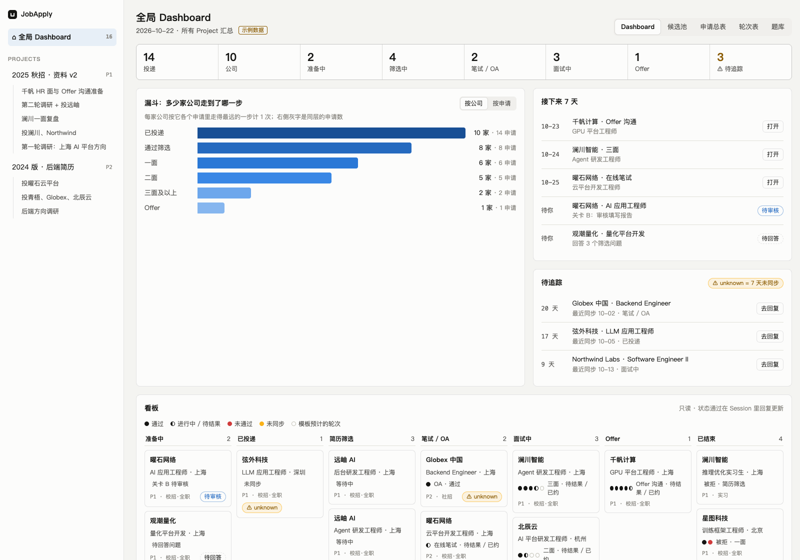
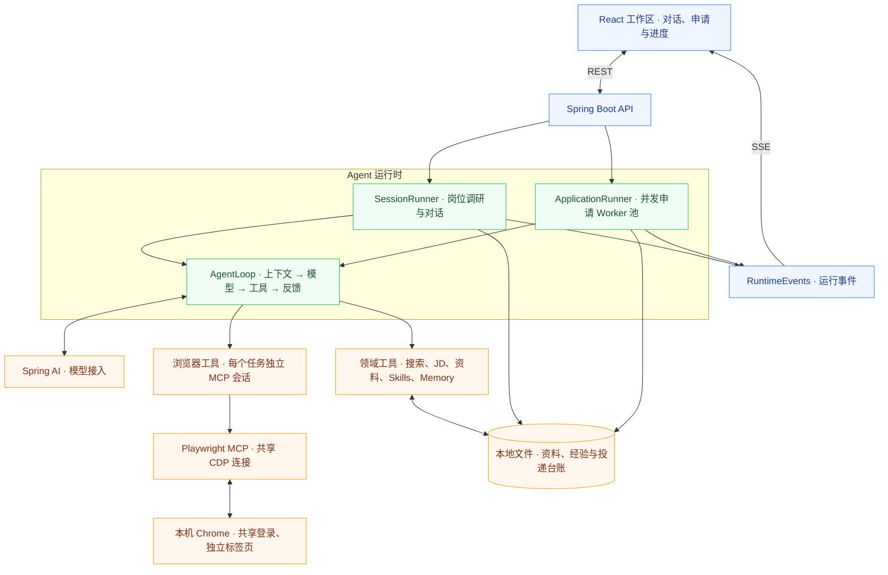
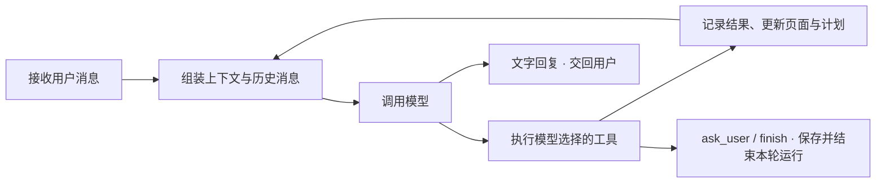

# JobApply

让 Agent 帮你找岗位、填申请，把时间留给选择和面试。

求职者每投一份简历，往往都要注册账号、上传文件，再把简历里的教育和项目经历填一遍。换一个招聘网站，又要重复同样的操作。完成投递后，还要记录申请进度、安排面试和跟进结果。

**JobApply 是一个在本机运行的求职 Agent。** 它根据你提供的资料和求职方向调研岗位、推荐简历，在你的 Chrome 里填写申请，并记录投递和面试进度。

你只需准备资料、说明要求，在需要时补充信息，并在浏览器中完成登录和最终提交。

[系统框架](#系统框架) · [Agent 设计](#agent-设计) · [技术实现](#技术实现) · [选型与借鉴](#选型与借鉴) · [本地运行](#本地运行)

## 功能概览

你可以用一句话开始求职：“帮我找上海的 Java 后端岗位，优先看应届生职位。”JobApply 会围绕这个目标完成以下工作：

- **找岗位。** 搜索职位、读取 JD、核实是否还在招聘，把合适的岗位放进候选池。
- **准备材料。** 根据岗位比较已有简历，给出修改建议，和你确定这次上传哪一份。
- **填申请。** 读取页面、填写表单、上传材料，并在缺少信息或遇到验证码时请你补充。
- **跟进结果。** 记录提交后的投递状态、面试轮次与复盘，在工作区汇总后续事项。



*界面示意来自[历史原型](plan/reference/ui-mockup.html)，使用虚构数据。[查看申请总表示意](docs/images/applications-demo.png)。*

## 系统框架

JobApply 用 **Project** 组织求职资料与方向，用 **Session** 保存调研和讨论，用 **Job** 跟踪岗位申请及后续进度。通过这三个对象，JobApply 将对话与岗位记录分开管理，支持跨对话继续推进同一份申请。



JobApply 根据 Session 中的求职要求搜索岗位、整理候选，并根据 JD 推荐简历。在用户确定岗位和材料后，JobApply 启动申请任务，在 Chrome 中填写表单、上传文件，再将填写报告和申请进度回传到对话。

用户可以在这段对话中持续补充资料、调整要求，完成申请前再审阅内容并亲自提交。

JobApply 采用共用的 AgentLoop 驱动调研与申请，通过不同的提示词、上下文和工具集区分两者的职责。它将页面与工具反馈交给模型选择下一步，随后执行调用并保存对话；需要补充信息时，它保存本轮结果，等待用户回复后继续执行。

## Agent 设计

JobApply 的核心是一个 Java Harness，负责组装上下文、调用模型、执行工具和保存对话。Harness 以 `AgentLoop` 为共用骨架，通过 `HarnessLoop` 处理申请，通过 `SessionLoop` 处理调研与对话。两个任务实现都通过 `messages`、`handle`、`roundDone` 等接口接入循环。

### Round Loop：模型决策与工具反馈

`AgentLoop` 将一次模型调用及其返回的一批工具执行作为一轮。它先接收用户插话，组装消息并调用模型，再将返回的工具调用逐个交给对应 Agent 执行。收齐结果后，它将结果加入对话，进入下一轮。



模型通过 `update_plan` 维护申请清单，通过 `ask_user` 请求补充信息，通过 `finish` 生成填写报告并交回用户。它根据每次工具调用的结果调整后续动作，包括处理执行失败时返回的错误。

Harness 负责保存这些调用和结果，并在收到用户回复后读取已有对话、追加新消息，继续运行。

JobApply 将运行职责分为三部分：通过 `ApplicationRunner` 调度申请任务，通过 `HarnessLoop` 处理单个任务的工具调用，通过 `AgentLoop` 控制模型与工具之间的轮转。

实现：[AgentLoop](backend/src/main/java/jobapply/harness/runtime/AgentLoop.java)、[HarnessLoop](backend/src/main/java/jobapply/harness/runtime/HarnessLoop.java)、[SessionLoop](backend/src/main/java/jobapply/harness/runtime/SessionLoop.java)。

### 消息格式与工具调用关联

JobApply 用 `AgentRun.Turn` 保存内部对话，在每条记录中保存角色、文字、工具调用、工具结果和附件。对于工具调用，JobApply 记录 `id`、`name` 和 JSON 参数；对于执行结果，它记录对应的调用 `id`、执行状态与耗时。

`Conversation` 在请求模型前将这些记录转换为 Spring AI 消息：

| 消息 | 内容与用途 |
| --- | --- |
| `SystemMessage` | Agent 的职责、工作方法与操作说明 |
| `UserMessage`（上下文） | 本轮使用的资料、Skills 索引、计划等运行信息 |
| `UserMessage`（对话） | 用户要求、补充回答与附件 |
| `AssistantMessage` | 模型回复及其 `toolCalls` |
| `ToolResponseMessage` | 按调用 ID 对应的执行结果，供下一轮模型判断 |

`Conversation` 在构建请求时完整保留最新页面快照，只保留历史页面的操作记录，避免重复发送整页内容。它会为缺少结果的工具调用补充中断说明，保持调用与结果成对；对于已保存的模型思考内容，它不再放回请求，只保留在对话记录中供界面展示。

JobApply 将申请对话和计划保存在 Job 的运行 JSON 中，将 Session 对话保存在 JSONL 中。后续运行时，JobApply 从这些记录重建模型消息，接着处理用户的新回复。

实现：[AgentRun](backend/src/main/java/jobapply/domain/AgentRun.java)、[Conversation](backend/src/main/java/jobapply/harness/context/Conversation.java)、[AgentRunStore](backend/src/main/java/jobapply/persistence/AgentRunStore.java)。

### System Prompt 与每轮上下文组装

JobApply 将稳定的工作说明与变化的任务资料分开组装：通过 `ApplyAgent` 拼接 system prompt，通过 `FillContext` 准备每轮上下文，再通过 `Conversation` 按“system prompt → 本轮上下文 → 历史对话”的顺序生成消息列表。

其中，system prompt 包括身份与目标、工作方法、场景指导、写作与记忆、操作约束；每轮上下文包括有效资料、本次回答、上传文件编号、Skills 索引、站点记录和模型计划。

JobApply 为调研和申请准备不同的输入。调研侧采用 `ResearchAgent` 的 system prompt，并通过 `SessionLoop` 提供日期、Project、用户画像、求职偏好、已有资料键和调研类 Skills；申请侧提供可填表的中英资料与本次申请信息，将任务集中在一个 Job 上。

Harness 通过 Spring AI 的 `ToolCallback` 随请求单独发送工具名称、说明和参数 Schema，并根据模型返回的名称和参数执行调用。

实现：[ApplyAgent](backend/src/main/java/jobapply/agents/ApplyAgent.java)、[ResearchAgent](backend/src/main/java/jobapply/agents/ResearchAgent.java)、[FillContext](backend/src/main/java/jobapply/harness/context/FillContext.java)、[ModelFactory](backend/src/main/java/jobapply/config/ModelFactory.java)。

### Skills 索引与按需加载

JobApply 通过 `SkillCatalog` 扫描 `playbook/skills/` 下的 `SKILL.md`，读取 frontmatter 中的名称、描述、分组和站点匹配信息。它在申请上下文中列出可用 Skills 的名称与描述，并推荐匹配招聘站点的 Skill；在调研上下文中则只列出 research 分组。

Harness 根据模型发出的 `read_skill(name)` 调用读取正文，以工具结果的形式返回，供下一轮使用。它只在收到调用后加载对应文件，无需预先将所有 Skill 正文放入上下文。

Agent 通过 `remember` 的 skill 类型更新已有方法。它先读取 Skill，再用唯一匹配的原文定位并替换段落，将本次积累的方法保留给后续申请。

实现：[SkillCatalog](backend/src/main/java/jobapply/harness/context/SkillCatalog.java)、[MemoryWriter](backend/src/main/java/jobapply/memory/MemoryWriter.java)。

### Memory 分层与资料解析

JobApply 按资料的用途建立四层 Memory，让原始材料、可用事实和求职表达各自保存：

| 层 | 保存的内容 | 在 Agent 中的用途 |
| --- | --- | --- |
| 来源层 | 上传原件、文件索引、本地目录与公开仓库的来源登记 | 保留资料出处，支持读取原件 |
| 证据层 | 来源清单、论断台账 | 关联经历与成果的依据 |
| 事实层 | 个人事实、项目卡、中英术语 | 提供填表与材料写作使用的具体内容 |
| 画像层 | 求职方向、技能分组、亮点与定位 | 为岗位调研和匹配提供概要 |

`ProfileResolver` 按 **本次回答 → 当前 Project 覆盖 → 父 Project 覆盖 → base 基础资料** 的优先级解析事实。它对同名事实采用高优先级的值，并通过 `unset` 屏蔽指定的继承值。

用户可以据此复用基础经历，同时为不同求职方向维护各自的资料。

JobApply 将操作经验单独保存在 Playbook 中，按域名组织站点记录，用 Skills 保存可复用的方法。它通过申请 Harness 读取站点记录，通过 `read_skill` 提供具体方法，并通过 `MemoryWriter` 执行 `remember` 请求，更新个人事实、站点和公司记录。对于已有内容，JobApply 支持替换和删除，减少重复追加。

实现：[ProfileResolver](backend/src/main/java/jobapply/memory/ProfileResolver.java)、[MemoryWriter](backend/src/main/java/jobapply/memory/MemoryWriter.java)；设计：[Memory 分层](plan/master/memory.md)。

### 分层 Markdown 与按需追溯

一组求职资料往往包含语义不同、逻辑相关的内容，例如同一段项目经历中的技术实现、个人职责和业务结果，或同一次求职中不同方向的岗位。这些内容仅靠相似度匹配容易被割裂，难以完整呈现所属关系和前后依据。

JobApply 选择分层 Markdown 来保留这些逻辑关系，按资料的归属组织内容，避免只从扁平向量索引中召回零散片段。

JobApply 在来源层保留原件，在证据与事实层保存整理后的内容，在画像层提供概要，并在 Job 与 Session 中保存申请过程的对话和记录。它通过 Project、Job 和来源引用连接这些资料，为模型提供沿业务关系读取内容的路径。

JobApply 借鉴 **[SillyTavern（酒馆）](https://github.com/SillyTavern/SillyTavern)** 的思路设计分层阅读，在上层资料中保留概要和指向下层资料的链接。

模型先阅读概要，再根据任务判断是否需要展开，沿引用追溯详细内容或原始材料。

JobApply 使用 Markdown 正文保存经历、经验和方法，使用 YAML frontmatter 保存字段与引用；对于运行状态、对话和事件，它分别采用 JSON 与 JSONL，并以 CSV 导出台账。

用户可以直接阅读、修改 Markdown 文件，也可以用 Obsidian 浏览资料之间的关系。

JobApply 用 Markdown 保存内容，用层级、归属和来源引用组织读取路径，不以扁平的相似度召回代替这些关系。

## 技术实现

JobApply 采用 Java 后端和 React 前端，通过 Spring AI 接入模型，通过 Playwright MCP 操作浏览器，并在自身的 Harness 中管理求职工具、循环、任务调度与资料保存。

| 部分 | 使用的技术 |
| --- | --- |
| 后端 | Java 25、Spring Boot 4.1.1 |
| 模型接入 | Spring AI 2.0.1，支持 OpenAI 兼容与 Anthropic 协议 |
| 浏览器 | Playwright MCP 0.0.83，通过 CDP 连接本机 Chrome |
| 前端 | React 19.3.1、TypeScript 7.0.2、Vite 8.3.4 |
| 文档解析 | Apache Tika 4.1.0 |
| 存储 | Markdown、YAML、JSON / JSONL、CSV |
| 实时更新 | REST + SSE |

版本来源：[后端依赖](backend/pom.xml)、[前端依赖](frontend/package.json)。

### Worker 池与独立浏览器会话实现并发申请

JobApply 采用 Worker 池调度申请，为每个任务分配独立的 MCP 会话和标签页，在共享 Chrome 登录状态的同时并行执行多份申请。它通过标签页归属和弹出页的 `opener` 确定任务对应的页面。

JobApply 分别管理总并发数和同站点并发数，在站点名额满时优先推进其他站点的申请。它通过保活会话维持共享 CDP 连接，在连续申请时沿用已有授权，并提供设置页供用户调整并发数量。

实现：[ApplicationRunner](backend/src/main/java/jobapply/workflow/ApplicationRunner.java)、[BrowserSession](backend/src/main/java/jobapply/tools/BrowserSession.java)、[OwnerBrowser](backend/src/main/java/jobapply/tools/OwnerBrowser.java)。

### 消息收件箱实现运行时 Steer

用户可以在 Agent 工作时直接补充要求，无需等待整份申请完成。

JobApply 通过消息收件箱实现这种 Steer 交互：它先保存补充要求，等当前一批工具执行完，再通过 AgentLoop 将消息加入下一次模型调用的上下文。对于运行结束时尚未处理的消息，JobApply 会通过 Runner 继续处理。

实现：[Inbox](backend/src/main/java/jobapply/domain/Inbox.java)、[AgentLoop](backend/src/main/java/jobapply/harness/runtime/AgentLoop.java)。

### SSE 事件续接与对话持久化

JobApply 将后台任务与前端事件订阅分离，通过 SSE 推送工具调用和申请进度。它为事件分配递增序号，在页面短暂断线后按序补发，并在页面刷新期间继续执行后台任务。

JobApply 将对话与任务状态保存到本地文件，在事件缓冲过期时提供已保存的状态供前端重新读取。服务重启后，JobApply 根据已保存的对话续接任务，并重新核对浏览器页面。

实现：[RuntimeEvents](backend/src/main/java/jobapply/workflow/RuntimeEvents.java)、[Conversation](backend/src/main/java/jobapply/harness/context/Conversation.java)。

JobApply 在模型上下文中使用 `{KEY}` 表示敏感字段，只在发送浏览器填表调用时替换为用户在设置页填写的真实值。它将资料保存在本机 `storage/` 中，并在调用云端模型或搜索服务时发送相应上下文。

## 选型与借鉴

### Spring AI 模型接入与自研 AgentLoop

JobApply 的早期实现采用 LangGraph4j，将申请步骤组织成固定节点，并在九处设置等待点。由于这套实现将登录判断和用户交接绑定到流程分支，新出现的页面行为往往需要通过修改节点逻辑处理。

JobApply 随后改用 Java Harness，将申请步骤交给模型根据工具反馈决定。它保留 Spring AI 的模型、消息和工具协议，通过 `AgentLoop` 控制每轮调用，通过 `HarnessLoop` 与 `SessionLoop` 处理申请和调研，从而直接管理消息组装、Skills 加载、用户插话与对话持久化。

| 方案 | JobApply 的选择与原因 |
| --- | --- |
| LangChain / Deep Agents | JobApply 借鉴其循环、Skills 和子任务机制，并在 Java 后端实现这些设计，使 Agent 与现有资料和浏览器工具运行在同一进程。 |
| LangGraph / LangGraph4j | JobApply 用 AgentLoop 替换了早期的 LangGraph4j 流程，通过保存对话、计划和运行状态实现暂停与续接。 |
| Spring AI Alibaba Graph | JobApply 在选型研究后采用模型与工具循环，自行管理运行状态，没有引入 Alibaba Graph。 |
| LangChain4j | JobApply 已通过 Spring AI 接入模型，因此没有再引入同属 Java 生态的 LangChain4j。 |
| Spring AI | JobApply 使用 Spring AI 接入模型与工具协议，自行管理工具执行和下一轮调用。 |

JobApply 移除 LangGraph4j 是为了调整自身的流程建模方式，并非认为图框架只能执行固定步骤；Deep Agents 就是在 LangGraph 上构建动态 Agent 的例子。

### 开源设计参考与实现

JobApply 参考 [OpenMAIC](https://github.com/THU-MAIC/OpenMAIC)、[Deep Agents](https://github.com/langchain-ai/deepagents) 和 [Hermes Agent](https://github.com/NousResearch/hermes-agent) 的源码与设计，用 Java 实现了以下机制。

**OpenMAIC：用户交接与事件续接。** JobApply 参考 OpenMAIC 课堂导演的 `cue_user` 机制，通过 `ask_user` 结束本次运行、请求补充信息，并在收到回复后续接对话。JobApply 还借鉴了 OpenMAIC 将运行与 SSE 读者分离、按序号补发事件的设计，采用本地文件保存状态、内存缓冲保存实时事件。

出处：[导演循环](https://github.com/THU-MAIC/OpenMAIC/blob/dff201b49857918885cc5ebadb4a8af254b6ae9d/lib/chat/pi/director-loop.ts)；落地：[HarnessLoop](backend/src/main/java/jobapply/harness/runtime/HarnessLoop.java)、[RuntimeEvents](backend/src/main/java/jobapply/workflow/RuntimeEvents.java)。

**Deep Agents：共用循环与按需加载。** JobApply 参考 Deep Agents 通过 `create_agent` 组装不同 Agent 的方式，用同一个 `AgentLoop` 驱动调研和申请，通过 `SessionLoop` 与 `HarnessLoop` 提供各自的上下文和工具处理。JobApply 也借鉴了它的 Skills 按需加载、工具中断结果补齐和子任务回报机制。

出处：[Agent 组装](https://github.com/langchain-ai/deepagents/blob/3e7d5faa9d275beb3d54f11266aac3c60e3d50b9/libs/deepagents/deepagents/graph.py)、[工具结果补齐](https://github.com/langchain-ai/deepagents/blob/3e7d5faa9d275beb3d54f11266aac3c60e3d50b9/libs/deepagents/deepagents/middleware/patch_tool_calls.py)；落地：[AgentLoop](backend/src/main/java/jobapply/harness/runtime/AgentLoop.java)、[Conversation](backend/src/main/java/jobapply/harness/context/Conversation.java)、[ApplicationRunner](backend/src/main/java/jobapply/workflow/ApplicationRunner.java)。

**Hermes：记忆更新与运行时插话。** JobApply 参考 Hermes 的分节提示词组织 `ApplyAgent`，采用轻量循环驱动工具执行，并通过 `MemoryWriter` 实现 add / replace / remove 记忆更新和 Skill 段落替换。JobApply 还参考 Hermes 的 `_pending_steer` 与 OpenMAIC 的 `agent.steer`，通过收件箱在下一次模型调用前注入用户消息。

出处：[主循环与 steer](https://github.com/NousResearch/hermes-agent/blob/e5dad4ac57ad11d39fe18b1ac895c0e0ae5b6494/run_agent.py)、[Memory 工具](https://github.com/NousResearch/hermes-agent/blob/e5dad4ac57ad11d39fe18b1ac895c0e0ae5b6494/tools/memory_tool.py)；落地：[ApplyAgent](backend/src/main/java/jobapply/agents/ApplyAgent.java)、[Inbox](backend/src/main/java/jobapply/domain/Inbox.java)、[MemoryWriter](backend/src/main/java/jobapply/memory/MemoryWriter.java)。

**[SillyTavern（酒馆）](https://github.com/SillyTavern/SillyTavern)：分层资料与按需展开。** JobApply 从酒馆项目获得启发，在上层资料中保留概要与引用，为模型提供按需追溯下层内容的路径。它据此组织原始材料、整理后的资料和运行记录，保留资料之间的上下文关系。

更完整的源码路径、研究版本和未采用的机制见[研究笔记](plan/reference/research-agent-design.md)。

## 本地运行

JobApply 的本地运行环境包括 JDK 25、Maven、满足 [Vite 8 要求](https://vite.dev/guide/)的 Node.js（20.19+ 或 22.12+）、npm，以及开启远程调试的 Chrome。

```bash
# 终端 1：在仓库根目录执行
# macOS Homebrew 用户：非交互 shell 下显式选择 JDK 25
export JAVA_HOME=/opt/homebrew/opt/openjdk@25/libexec/openjdk.jdk/Contents/Home
cd backend
mvn -B -DskipTests package
java -jar target/jobapply-0.0.1-SNAPSHOT.jar
```

```bash
# 终端 2：在仓库根目录执行
cd frontend
npm ci
npm run dev
# 打开 http://127.0.0.1:5173
```

首次使用：

1. 在“设置 → 模型”添加提供方、配置模型，分配主模型与辅助模型。
2. 在资料页上传简历，整理并确认事实与画像；按需求建立 Project。
3. 在 Chrome 的 `chrome://inspect/#remote-debugging` 开启远程调试；首次连接时允许访问。通过 CDP 连接，无需安装 MCP 扩展。
4. 新建 Session 描述求职目标，选择岗位和简历后启动申请；按提示完成登录或验证码，并在 Agent 填写完成后审阅、提交。

JobApply 的后端默认监听 `127.0.0.1:8080`，通过前端开发服务器的 `/api` 代理接收请求。JobApply 默认将数据保存在仓库根目录下的 `storage/`，通过设置页管理密钥。

## 继续阅读

- [运行时设计](plan/master/agent-runtime.md)：循环、工具、提示词与用户交接。
- [模块职责](plan/master/architecture.md)：后端分层与职责。
- [源码研究笔记](plan/reference/research-agent-design.md)：参考项目到本项目实现的取舍。
